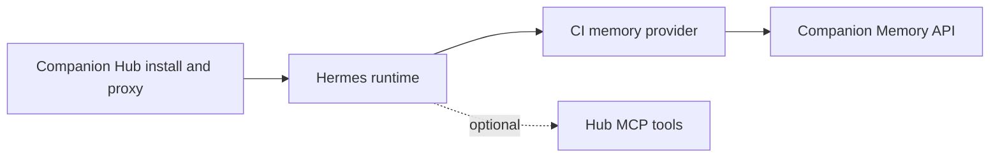
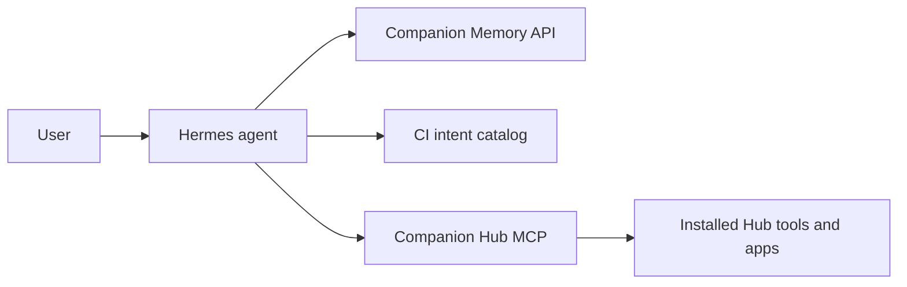

<h1 align="center">Hermes - Companion Memory Edition</h1>

<p align="center"><strong>Web terminal and official Hermes dashboard for running Hermes Agent on the Companion Intelligence (CI) marketplace.</strong></p>

[](https://github.com/companionintelligence/CI-Hermes/releases/latest)
[](https://github.com/companionintelligence/CI-Hermes)
[](LICENSE)
[](https://discord.com/invite/yQp9hwpzAa)

<p align="center"><a href="https://hub.ci.computer/store/hermes">Website</a> · <a href="#license">License</a> · <a href="https://docs.ci.computer/docs/reference/open-source-systems">Systems map</a> · <a href="ci-context/plugins/companionintelligence/README.md">Documentation</a></p>

<p align="center">
  <a href="https://hub.ci.computer/store/hermes"></a>
</p>


## [Designed to run with Companion Memory](https://hub.ci.computer/store/ci-memory)

### Connect Hermes to CI Memory

Hermes ships with the Companion Intelligence memory provider already installed.
There are two ways to connect it to your Companion Memory Server:

- **Automatic (recommended)** — first generate an API key (**Step 1** below),
  then enter the URL (`http://host.docker.internal:8642`) and that key into the
  **Companion Memory URL** and **Companion Memory API Key** fields of the Hermes
  **install dialog**. The provider is enabled and selected as your active
  memory backend automatically — no terminal step needed. On a brand-new
  install it activates on the **first restart after install** (the app needs
  one startup to generate its config before the provider can be selected), so
  restart the Hermes app once from the CI marketplace if memory isn't active
  yet. If you later switch providers by hand, your choice is preserved across
  restarts.
- **Manual** — leave those install fields blank and run the interactive
  `hermes memory setup` wizard later, as described in **Step 2**.

#### Step 1 — Install Companion Memory and generate an API key (do this first)

Hermes connects *to* a running Companion Memory Server, so set that up before
touching the Hermes terminal:

1. In the **CI marketplace**, install the **[Companion Memory](https://hub.ci.computer/store/ci-memory)**
   app and wait for it to finish starting.
2. **Open the Companion Memory app** and complete its onboarding if prompted.
3. Go to **Settings → API Keys**, click the **`+`** button, give the key a name
   (e.g. `Hermes`), optionally set an expiry, and click **Create**.
4. **Copy the key immediately** — it is shown only once and cannot be retrieved
   later. Keep it handy for Step 2.

#### Step 2 — Run memory setup in the Hermes terminal

> **Important — chat mode vs. CLI mode.** When you open the Hermes terminal (the
> CI marketplace app, e.g.
> `https://<your-host>.companionintelligence.com/terminal`), it drops you
> straight into **chat with Hermes**. `hermes memory setup` is a command-line
> command, **not** a chat message — if you type it at the chat prompt (`❯`)
> Hermes just answers it like a question and nothing gets configured. You must
> switch to the shell first.

1. **Open the Hermes terminal** from the CI marketplace (the `/terminal` path).
   You'll land in chat mode by default.
2. **Press `Ctrl+D`** to exit chat and drop into the underlying shell (CLI mode).
   You'll see a normal shell prompt instead of the `❯` chat prompt.
3. Have the **API key from Step 1** ready — if you leave it blank and no key is
   already set in `CI_SERVER_TOKEN`, the wizard cancels.
4. At the shell, run:

   ```
   hermes memory setup
   ```

   If `companionintelligence` is the only memory provider, the wizard starts its
   setup directly; otherwise **select `companionintelligence`** from the list (it
   is pre-installed — no extra install step needed).
5. **CI-Server URL** — at the `CI-Server URL [http://127.0.0.1:8642]:` prompt,
   enter:

   ```
   http://host.docker.internal:8642
   ```

   > ⚠️ **Do not accept the `http://127.0.0.1:8642` default.** Inside the Hermes
   > container `127.0.0.1` is Hermes itself, not the Memory Server. The Companion
   > Memory app publishes its gateway on the **host** at port `8642`, and Hermes
   > reaches the host via `host.docker.internal` (the same way it reaches the CI
   > Hub). So use `http://host.docker.internal:8642`.
   >
   > If host-gateway access is ever blocked, the Memory gateway also joins the
   > shared CI network — `http://gateway:8642` works as a fallback.

6. **API key** — paste the key from **Step 1** and press Enter. If a key is
   already set in `CI_SERVER_TOKEN`, leaving this blank keeps the current key;
   otherwise leaving it blank prints `✗ Both URL and API key are required. Setup cancelled.` and exits without saving.
7. The wizard runs a **connection test** (`GET /api/health`) against the URL with
   your key. **Nothing is saved unless it succeeds** — if you see an error, fix
   the URL/key and run `hermes memory setup` again. On success it saves the key
   to `.env`, the URL to `companionintelligence/config.json`, and sets
   `memory.provider: companionintelligence` in `config.yaml`.
8. **Restart the Hermes app** from the CI marketplace. Memory is now active in both the terminal (`/terminal`) and the web chat (`/chat`); `hermes memory status` confirms it, and once it recalls something for a message you'll see `🧠 Companion Memory — recalled N memories` beside the reply.

   You do **not** need to enable anything on the Hermes **`/plugins`** page. Memory providers are activated by `memory.provider` alone; that page is the general plugin loader, which will keep listing `companionintelligence` as *not enabled* — a look, not a missed step (see the [plugin README](ci-context/plugins/companionintelligence/README.md#install)).

> **Tip:** While in CLI mode you can also run other admin commands such as
> `hermes model` and `hermes doctor`. Press `Ctrl+D` from chat any time you need
> the shell.

⚠️ WARNING: Running this on systems other than the CI marketplace is likely very insecure. This configuration is only secure when running behind the CI app proxy.


## Features

| Feature | What it provides |
|---|---|
| **Hermes runtime** | Run the upstream agent runtime and its web terminal as a Hub app. |
| **Memory provider** | Install a versioned provider for Companion Memory search and writes. |
| **CI intent tools** | Expose selected Companion Intelligence intents to Hermes. |
| **Optional Hub tools** | Connect to Hub MCP separately for platform and installed-app tools. |


## What is this?

This repo builds the CI marketplace wrapper image for Hermes Agent. It does not fork Hermes itself — it layers a terminal UI, onboarding flow, and CI runtime context on top of the [official Hermes Agent Docker image](https://github.com/NousResearch/hermes-agent). It provides:

- A web-based terminal UI (xterm.js) that drops you straight into chat with Hermes
- Automatic setup detection using Hermes' own runtime provider resolver — runs the setup wizard only when no usable provider credentials are configured
- The official Hermes web dashboard, proxied through the terminal server and protected by CI marketplace authentication
- A separate gateway container using the same wrapper image with a CI gateway entrypoint that launches Hermes in `gateway run` mode for messaging platform integrations
- Sandboxing so Hermes runs in its own environment that can't mess up other CI apps
- CI-specific runtime context and a `ci` skill, wired through Hermes' supported plugin/skills surfaces so the agent understands its containerized CI environment


## How it fits together

Hub installs and proxies the containerized Hermes runtime; the CI provider connects Hermes to Memory, while Hub MCP remains a separate optional platform-tools connection.



## Architecture

Two containers share a single data volume (`/opt/data`):

- **web** — Node.js server providing the terminal UI (xterm.js + PTY) and the official Hermes dashboard (running as a background process, proxied via localhost). This is the main entry point behind the CI app proxy.
- **gateway** — Same wrapper image, running a dedicated CI gateway entrypoint that applies managed bootstrap and then executes `hermes gateway run`.

The terminal is served at `/terminal` (the CI marketplace app entry point). The dashboard owns `/` and all other paths are proxied to it, ensuring it's protected by CI marketplace authentication.

### LLM connection layer

Two build-time shims in [`patches/`](patches/) sit between Hermes and its model backend, applied to the upstream image at Docker build time via `.pth` files (loaded at Python interpreter startup):

- [`ollama_native_adapter.py`](patches/ollama_native_adapter.py) / [`enable_ollama_native.py`](patches/enable_ollama_native.py) — routes local Ollama through its native `/api/chat` endpoint (which honors `num_ctx`) instead of the OpenAI-compatible `/v1` endpoint (which silently ignores it and falls back to Ollama's 4096-token default).
- [`enable_gateway_health_auth.py`](patches/enable_gateway_health_auth.py) — sends the gateway's Bearer key with the dashboard's `/health/detailed` probe, so the two-container split doesn't leave the dashboard's health check permanently unauthenticated.

Each shim patches upstream by name and is deliberately best-effort — a missing hook is logged and Hermes falls back to stock behavior rather than crashing. A matching static contract check ([`check_ollama_native_contract.py`](patches/check_ollama_native_contract.py), [`check_gateway_health_auth_contract.py`](patches/check_gateway_health_auth_contract.py)) parses the upstream source with `ast` at build time and fails the image build if a base-image bump has moved what the shim hooks into — see the Dockerfile. Run `python3 -m unittest discover -p '*_test.py'` in `patches/` (needs `httpx`) to run their unit tests without a build.

Separately, [`reconcile-hub-config.py`](reconcile-hub-config.py) keeps `config.yaml`'s model/endpoint settings following the Hub's inference handout on every start — ownership tracking so hand edits survive, the 64K context-window floor, and cloud-handout precedence. See its module docstring and [`tests/hub-handout-restart.test.sh`](tests/hub-handout-restart.test.sh) for the full contract.

## CI context

The image includes a bundled `ci-runtime` plugin under `/opt/hermes/plugins` and a managed `ci` skill under `/app/ci-context/skills`. Both are app-owned image content, so they update with normal CI marketplace app image updates without writing managed prompt files into the user's persistent data directory.

On startup, `/app/bootstrap-ci-context.sh` idempotently:

- Enables the bundled `ci-runtime` plugin in `/opt/data/config.yaml`, so Hermes carries compact CI runtime context in every session — as a frozen system-prompt section (`## Plugin Context: ci-runtime`, rendered once per session), falling back to the per-turn `pre_llm_call` hook on a Hermes older than v0.21.
- Adds the managed skills directory to `skills.external_dirs` in `/opt/data/config.yaml` when the config exists.

To connect it to Companion Memory you have two options (see *Connect Hermes to CI Memory* above for the full walkthrough): enter the **Companion Memory URL** and **API Key** in the app's install dialog and it activates automatically on startup, or run `hermes memory setup` in the terminal and follow the instructions. Either way, generate your API key from the CI-Server settings page.

### Using the memory provider on a stock Hermes install

The `companionintelligence` memory provider is not appliance-only. It is published as a versioned tarball at [`@companionintelligence/hermes-memory`](https://www.npmjs.com/package/@companionintelligence/hermes-memory), so anyone running stock Hermes can extract it into `~/.hermes/plugins/companionintelligence/` and run `hermes memory setup` — Hermes has no plugin registry, so a directory in the plugins dir *is* the install. The user-facing instructions live with the source, in [`ci-context/plugins/companionintelligence/README.md`](ci-context/plugins/companionintelligence/README.md); releases are cut by `.github/workflows/npm-publish.yml` from the `vYYYY.M.D` release tags that also publish the image. Not every image release mints a plugin version, though: both workflows fire on the same release-tag glob, but this one compares the packed plugin against what is already published and skips when nothing changed, so a release that leaves the plugin unchanged publishes nothing to npm.

### Callable CI intents (tools)

When Companion Memory is connected, the memory provider does more than describe CI-Server's curated intent catalog (`GET /api/agent/intents`, legacy `/api/intents`) in the system prompt — it also registers the catalog's read-only, appliance-local intents as callable tools, so the agent can execute them mid-session (e.g. `predictions_forecast`) through CI-Server's generic REST executor (`POST /api/intents/<name>/execute`). Destructive or external intents are never registered; the server independently refuses them with a 403.

Feature flags (all default **on**):

- `CI_INTENTS_ENABLED=false` — turn off the whole intent-catalog integration (prompt block + tools)
- `CI_INTENT_TOOLS_ENABLED=false` — keep the prompt catalog but do not register callable tools

Requires a CI-Server build with the REST intent executor; on older servers the catalog stays prompt-only and tool calls degrade to a structured error result instead of failing the session.

## Hub MCP (platform tools)

On CI marketplace installs with MCP enabled, the Hub injects `HUB_MCP_URL` and `HUB_MCP_API_KEY`. Bootstrap order is:

1. `/app/bootstrap-from-hub.sh` — fetches the Hub's inference handout and makes `config.yaml` follow it (creating the file on first boot; see *Hub inference handout*)
2. `/app/bootstrap-ci-context.sh` — runs `configure-ci-server.py` (optional CI-Server memory MCP) and `configure-hub-mcp.py` (Hub platform MCP)

The Hub block is written under `mcp_servers.hub` pointing at the Hub's Streamable HTTP MCP endpoint (`…/api/mcp`) with `Authorization: Bearer` headers and **no** `transport:` line (the agent's default MCP client speaks Streamable HTTP). It mirrors the optional `ci_server` memory MCP block, with which it coexists.

Run the smoke tests:

```bash
bash tests/hub-mcp-smoke.sh
bash tests/configure-hub-mcp.test.sh
```

If Hub MCP is disabled on the Hub, run `cihub mcp setup` and restart the Hermes app to pick up new credentials.

## Hub inference handout

On every start, both containers fetch the Hub's handout for the app
(`GET $CI_HUB_URL/api/inference/apps/hermes-agent/credentials.env`, alias
`bootstrap.env`) into `/opt/data/.env.hub-bootstrap`, and
`reconcile-hub-config.py` makes the Hub-managed part of `config.yaml` follow it:
`model.default`, `model.base_url` / `api_key`, `model.ollama_num_ctx` /
`context_length`, the `providers.ollama` picker entry (the endpoint upstream actually
resolves for `provider: ollama`) and `auxiliary.*` side-task routing.

- **`config.yaml` is the single source of truth.** The loaders (`hub-env.sh`, and
  `hub-env.cjs` for terminal sessions) never export `HERMES_INFERENCE_MODEL`,
  `HERMES_MODEL` or `OPENAI_MODEL`, nor — for the Hub's own endpoint —
  `CUSTOM_BASE_URL` / `CUSTOM_API_KEY` / `OPENAI_*`. Upstream ranks those over
  `config.yaml` for the life of a process, so the dashboard and the gateway could run
  different models and ignore a corrected config. A config change now reaches running
  processes through Hermes' own config reload.
- **Your edits are kept.** What the bootstrap wrote is recorded in
  `/opt/data/.hub-managed-config.json`; a value that no longer matches its record (a
  GUI model switch, a hand edit, a provider you picked) is left alone and logged as
  `kept user-set …`. Remove the model key, the `providers.ollama` entry or the
  `auxiliary` section from `config.yaml` to hand it back to the Hub.
- **A model below Hermes' 64K minimum is refused.** If the Hub switches to a model
  whose window is under 64,000 tokens, the previous Hub model is kept; either way the
  problem is logged as an `ERROR` and printed at the top of the web terminal
  (`/opt/data/.hub-inference-warning`).
- **A Hub that isn't up yet is asked again.** Right after a reboot Hermes can start
  before the Hub listens. Both containers then keep the last handout and ask again
  every 30 s (`HUB_BOOTSTRAP_RETRY_INTERVAL`) until the Hub answers once. The answer
  is applied as at start. The model and the Hub's own endpoint reach the running
  processes through `config.yaml`; a cloud endpoint travels in env and reaches them
  at their next start. An HTTP error or an empty answer ends the asking. Terminal
  sessions fetch on their own each time they open.
- **A cloud handout does not displace the Hub endpoint.** The Hub hands out a cloud
  provider when its local inference is down as the app starts; CI-Hermes logs it and
  stays on the local endpoint rather than moving conversations to a paid provider.

## Hub cloud inference tokens

Hub → Settings → AI can store OpenAI, Anthropic, Google, and GitHub Copilot keys. On every start, `bootstrap-ci-context.sh` registers each present `CI_CLOUD_<PROVIDER>_API_KEY` / `_BASE_URL` / `_MODEL` under `providers:` so the dashboard picker can offer them **alongside** local Ollama (`HERMES_OPENAI_*`). A saved cloud key does not replace the local backend. Removing a key from Hub Settings drops that provider on the next restart.

## Error reporting

The wrapper reports its own crashes to Sentry. It is **opt-out**: on any build
configured with a `SENTRY_DSN` — as release images are — reporting is on until
the user turns it off. With no `SENTRY_DSN` (a source checkout, a local
`docker compose up`) the SDK is never loaded and the container makes no outbound
connection; that is the absence of configuration, not a privacy setting. The app
store's **Share crash reports** toggle, `CI_TELEMETRY=off` or
`CI_LOCAL_ONLY=true` turn it off without a rebuild, and
`GET /__ci_telemetry/config` reports which switch is in effect. Only
`server.cjs` is instrumented — not the upstream Hermes dashboard or gateway.

See [docs/operations/error-reporting.md](docs/operations/error-reporting.md) for
the privacy posture and the full redaction rules.

<!-- companion-hub-readme-deep-review -->

## Integration flow

| Step | Service | What it provides |
|---|---|---|
| 1 | Companion Memory | Persistent memory API and the user-scoped API key |
| 2 | Hermes | Agent runtime, memory provider, and callable CI intents |
| 3 | Companion Hub (optional) | Platform tools through Hub MCP and configured inference |



The standalone memory provider can run without Hub MCP; Hub tools and Hub inference are optional integrations. Keep each service URL and credential in its own configuration and use the troubleshooting/error-reporting sections when a connection fails.

## License

MIT
